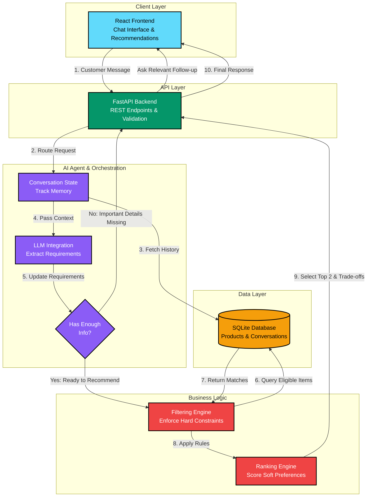

# ElectroAdvisor AI — Intelligent Electronics Sales Assistant

> **AI Engineer Technical Assessment** · 3-Day Build Challenge · Electronics Recommendation Agent

ElectroAdvisor is a production-grade AI-powered sales assistant designed for an electronics store. Customers often know their practical goals (e.g., college coursework, local machine learning experiments, carrying between campus lectures), but rarely know the exact technical specifications they need.

ElectroAdvisor engages in a natural multi-turn conversation, dynamically tracks customer requirements across messages, differentiates **hard constraints** (e.g., maximum budget ceiling) from **soft preferences** (e.g., weight, portability, battery life), uses **controlled database query tools**, and recommends the **two most suitable products** grounded in real catalog data with explicit reasons and trade-offs.

---

## 📑 Table of Contents
1. [Architecture & Decision Flow](#-architecture--decision-flow)
2. [FARM Stack Compliance](#-farm-stack-compliance)
3. [Filtering & Ranking Engine Specification](#-filtering--ranking-engine-specification)
4. [Project Directory Structure](#-project-directory-structure)
5. [Quickstart Setup Guide](#-quickstart-setup-guide)
6. [Automated Test Suite](#-automated-test-suite)
7. [API Reference](#-api-reference)
8. [Edge Cases & Reliability](#-edge-cases--reliability)
9. [Assessment Timeline & Check-ins](#-assessment-timeline--check-ins)

---

## 🏛 Architecture & Decision Flow

### Mermaid.js Architecture Flowchart


### ASCII Box Architecture Diagram
```text
 ┌─────────────────────────────────────────────────────────┐
 │                     REACT FRONTEND                      │
 │    (Chat Interface, Product Cards, Trade-off Display)   │
 └──────────────────────────┬──────────────────────────────┘
                            │ 1. Customer Message
                            ▼
 ┌─────────────────────────────────────────────────────────┐
 │                   FASTAPI BACKEND                       │
 │  (/conversations/{id}/messages, Validation, Routing)    │
 └──────────────────────────┬──────────────────────────────┘
                            │ 2. Process Message
                            ▼
 ┌─────────────────────────────────────────────────────────┐
 │               AI AGENT ORCHESTRATION                    │
 │  ┌──────────────┐   ┌─────────────┐   ┌──────────────┐  │
 │  │ LLM Engine   │──▶│ State       │──▶│ Orchestrator │  │
 │  │ (Extraction) │   │ Manager     │   │ (Decision)   │  │
 │  └──────────────┘   └─────────────┘   └──────┬───────┘  │
 └──────────────────────────────────────────────┼──────────┘
           ▲                                    │ 3. Check Info
           │ (Missing Info: Loop back to UI)    ▼
           │                           /─────────────────\
           └──────────────────────────/ Enough Info for   \
                                      \ Recommendation?   /
                                       \─────────────────/
                                                │ (Yes)
                                                ▼
 ┌─────────────────────────────────────────────────────────┐
 │              FILTERING & RANKING ENGINE                 │
 │  ┌──────────────────────┐       ┌────────────────────┐  │
 │  │ Filtering Engine     │──────▶│ Ranking Engine     │  │
 │  │ (Hard constraints:   │       │ (Soft preferences: │  │
 │  │ Budget, Category)    │       │ Portability, Specs)│  │
 │  └──────────┬───────────┘       └─────────┬──────────┘  │
 └─────────────┼─────────────────────────────┼─────────────┘
               │ 4. Query Matching Items     │ 5. Select Top 2 
               ▼                             ▼
 ┌─────────────────────────────────────────────────────────┐
 │                   SQLITE DATABASE                       │
 │ ┌──────────────────┐ ┌────────────────┐ ┌─────────────┐ │
 │ │ Products Catalog │ │ Conversations  │ │ Messages    │ │
 │ └──────────────────┘ └────────────────┘ └─────────────┘ │
 └─────────────────────────────────────────────────────────┘
```

---

## ⚡ FARM Stack Compliance

The assessment requires **FastAPI** plus at least one more component from the **FARM** stack (FastAPI, React, MongoDB).
- **FastAPI:** Core backend REST API with asynchronous endpoints, Pydantic v2 schemas, and structured logging.
- **React:** Modern single-page application built with Vite and responsive Vanilla CSS, featuring live requirement memory inspection, product recommendation cards, and a comparative trade-off matrix.
- **Relational Data Layer:** SQLite via SQLAlchemy 2.0 ORM with synthetic catalog seeding.

---

## 🔍 Filtering & Ranking Engine Specification

### Stage 1: Hard Constraints Enforcement (Application Logic)
Mandatory constraints are strictly enforced in application code before ranking:
1. **Category Filter:** Product category must match target category (e.g., `laptop`, `smartphone`).
2. **Strict Maximum Budget Cap:** Any product where `product.price > budget_max` is immediately disqualified.
3. **Hardware Mandatory Thresholds:**
   - If customer requires **local machine learning**, application logic requires `min_ram_gb >= 16` and a **dedicated NVIDIA RTX GPU** with CUDA tensor cores (or Apple Unified Memory).
   - If customer requires **gaming**, dedicated GPU is mandatory.
4. **Stock Availability:** `product.stock > 0`.

> **Honest No-Match Handling:** If 0 products satisfy mandatory constraints (e.g. an RTX 4090 laptop under ₹30,000), the system does **not** hallucinate products or violate constraints. Instead, it explains the exact bottleneck and suggests realistic alternatives.

### Stage 2: Soft Preference & Use-Case Ranking Algorithm
Products passing Stage 1 are scored on a scale from 0 to 100 points:

$$\text{Score} = S_{\text{use-case}} + S_{\text{portability}} + S_{\text{battery}} + S_{\text{value}} + S_{\text{rating}}$$

| Component | Max Points | Evaluation Logic |
| :--- | :---: | :--- |
| **Use-Case Alignment ($S_{\text{use-case}}$)** | 40 pts | Matches between customer's `primary_uses` and `product.intended_uses`. Bonus for dedicated VRAM $\ge$ 6GB on ML tasks. |
| **Portability ($S_{\text{portability}}$)** | 20 pts | Weight $\le$ 1.35kg (+20 pts), 1.35–1.65kg (+15 pts), 1.65–2.15kg (+8 pts), $> 2.3$kg (+2 pts). Amplified when campus commute is mentioned. |
| **Battery Life ($S_{\text{battery}}$)** | 15 pts | Runtime $\ge 14$h (+15 pts), $\ge 9$h (+12 pts), $\ge 6.5$h (+8 pts), $< 6.5$h (+4 pts). |
| **Budget Optimization ($S_{\text{value}}$)** | 15 pts | Evaluates hardware efficiency within budget without exceeding the ceiling. |
| **Rating & Reliability ($S_{\text{rating}}$)** | 10 pts | $(\text{Rating} / 5.0) \times 10$. |

### Stage 3: Complementary Top-2 Selection
- **Rank #1:** Highest overall scoring model.
- **Rank #2:** Highest scoring model that offers a distinct, meaningful trade-off (e.g., maximum GPU compute vs. lightweight campus portability & battery endurance).

---

## 📁 Project Directory Structure

```
Intern_AI_Assessment/
├── backend/
│   ├── app/
│   │   ├── main.py               # FastAPI entrypoint, CORS, lifespan
│   │   ├── config.py             # Settings (pydantic-settings)
│   │   ├── database.py           # SQLite connection & sessionmaker
│   │   ├── models/               # SQLAlchemy ORM models (Product, Conversation, Message)
│   │   ├── schemas/              # Pydantic validation schemas
│   │   ├── api/                  # REST API routers (health, products, conversations)
│   │   ├── agent/                # Recommendation Agent Core
│   │   │   ├── state.py          # Multi-turn state manager & entity tracking
│   │   │   ├── orchestrator.py   # Decision orchestrator (Info sufficiency evaluation)
│   │   │   ├── extractor.py      # Dual-mode entity extractor (LLM + Regex rules)
│   │   │   ├── filter_rank.py    # Hard constraint filter & soft preference ranker
│   │   │   ├── explainer.py      # Spec-accurate rationales & trade-off generator
│   │   │   └── tools.py          # Controlled, parameterized database queries
│   │   └── data/
│   │       ├── seed_data.py      # 23+ realistic synthetic electronics records
│   │       └── init_db.py        # Database creation and seeding script
│   ├── tests/                    # 20 automated pytest test cases
│   ├── requirements.txt
│   ├── .env.example
│   └── pytest.ini
├── frontend/                     # React (Vite SPA)
│   ├── src/
│   │   ├── components/
│   │   │   ├── Header.jsx        # Navigation, live health badge, actions
│   │   │   ├── MessageBubble.jsx # Markdown chat messages & recommendation container
│   │   │   ├── ProductCard.jsx   # Product specs, match score, pros/cons
│   │   │   ├── TradeOffMatrix.jsx# Side-by-side trade-off comparison table
│   │   │   ├── StateInspector.jsx# Real-time agent memory & requirements inspector
│   │   │   ├── CatalogModal.jsx  # Database catalog browser
│   │   │   └── ArchitectureModal.jsx # Mermaid & ASCII architecture diagrams
│   │   ├── App.jsx               # Main application controller & quick prompts
│   │   ├── index.css             # Polished dark-mode design system
│   │   └── main.jsx
│   ├── package.json
│   └── vite.config.js
├── docs/
│   └── architecture.md           # Day 1 Architecture deliverable documentation
└── README.md
```

---

## 🚀 Quickstart Setup Guide

### Prerequisites
- **Python 3.10+** (Tested on Python 3.12)
- **Node.js 18+** & **npm**

### 1. Backend Setup
```bash
# Navigate to the backend directory
cd backend

# Create and activate virtual environment
python -m venv .venv

# Windows PowerShell:
.\.venv\Scripts\Activate.ps1
# Linux / macOS:
# source .venv/bin/activate

# Install dependencies
pip install -r requirements.txt

# Initialize and seed the SQLite database with 23 synthetic products
python -m app.data.init_db

# Start the FastAPI server (running on http://127.0.0.1:8000)
uvicorn app.main:app --reload --port 8000
```

> **API Documentation:** Interactive Swagger UI is available at **http://127.0.0.1:8000/docs**.

### 2. Frontend Setup
Open a second terminal window:
```bash
# Navigate to the frontend directory
cd frontend

# Install Node dependencies
npm install

# Start the Vite development server (running on http://127.0.0.1:5173)
npm run dev
```

Open **http://127.0.0.1:5173** in your browser.

---

## 🧪 Automated Test Suite

The backend includes a comprehensive automated test suite built with `pytest` covering 20 distinct test cases across functional requirements, edge cases, and the assessment benchmark conversation:

```bash
cd backend

# Windows:
.\.venv\Scripts\python.exe -m pytest

# Linux / macOS (or any active virtual environment):
pytest
# or
python -m pytest backend/tests
```

### Docker Quickstart (Optional)
You can run the entire FARM stack (FastAPI backend + React frontend) with a single command:
```bash
docker compose up --build
```
- Frontend available at: `http://localhost:5173`
- Backend API available at: `http://localhost:8000` (Swagger docs at `http://localhost:8000/docs`)

---

## 🧠 Why This LLM / Agent Approach Fits the Task

Section 4 of the assessment invites candidates to choose an LLM / agent framework and explain why the approach fits the problem.

We chose an **Orchestrated Stateful Agent with a Dual-Mode (LLM + Deterministic NLP) Extractor**:
1. **Zero Hallucination of Database Records:** Naive LLM agents that generate SQL or choose products directly frequently hallucinate model numbers, prices, or technical specifications. In ElectroAdvisor, the LLM is restricted to **structured entity extraction** (turning text into Pydantic models). Product retrieval, filtering, and scoring are executed strictly in deterministic Python code and SQLAlchemy ORM.
2. **Explicit Decision Orchestrator vs. Blind Questionnaires:** Instead of relying on a rigid state machine questionnaire or an unconstrained LLM loop, an explicit Decision Graph evaluates requirement completeness. It asks a focused question when essential fields (use case, budget, or local vs. cloud) are missing, and transitions immediately to recommendation once requirements are sufficient.
3. **Reproducible, Zero-Cost Evaluation:** By supporting Google Gemini and OpenAI with a deterministic fallback, recruiters and automated CI pipelines can clone and test the repository without needing paid API keys or hitting external rate limits.

---

## 📡 API Reference & Payload Examples

### 1. `GET /api/v1/health`
**Purpose:** Check application health and SQLite catalog count.  
**Response (200 OK):**
```json
{
  "status": "ok",
  "service": "ElectroAdvisor AI Sales Assistant API",
  "database": "connected",
  "products_count": 23
}
```

### 2. `GET /api/v1/products`
**Query Parameters:** `category`, `brand`, `min_price`, `max_price`, `search`, `page`, `limit`  
**Validation:** Returns `422 Unprocessable Entity` if `min_price > max_price`.  
**Response (200 OK):**
```json
{
  "total": 23,
  "page": 1,
  "limit": 2,
  "pages": 12,
  "items": [
    {
      "id": "LAP-001",
      "name": "Lenovo IdeaPad Slim 3 15",
      "brand": "Lenovo",
      "category": "laptop",
      "price": 42990.0,
      "rating": 4.3,
      "specs": { "ram_gb": 8, "gpu_type": "integrated", "weight_kg": 1.62 }
    }
  ]
}
```

### 3. `GET /api/v1/products/{product_id}`
**Response (200 OK):** Full product details including `specs`, `intended_uses`, `features`, `pros`, and `cons`.  
**Error (404 Not Found):** `{"detail": "Product with ID 'INVALID-1' not found"}`

### 4. `POST /api/v1/conversations`
**Purpose:** Initialize a new customer conversation.  
**Response (201 Created):**
```json
{
  "id": "conv_a1b2c3d4e5f6",
  "status": "active",
  "state": { "category": "laptop", "budget_max": null, "primary_uses": [] },
  "messages": []
}
```

### 5. `POST /api/v1/conversations/{id}/messages`
**Request Body:** `{"content": "Around 80,000. Mostly local experiments, and I carry it around campus."}`  
**Validation:** Returns `422` if message is empty or whitespace only.  
**Response (200 OK):**
```json
{
  "conversation_id": "conv_a1b2c3d4e5f6",
  "user_message": { "id": 1, "sender": "customer", "content": "Around 80,000..." },
  "agent_message": { "id": 2, "sender": "agent", "content": "Based on your requirements..." },
  "decision": {
    "action": "recommend",
    "recommendations": [
      {
        "product": { "id": "LAP-004", "name": "Acer Nitro V 15", "price": 76990.0 },
        "why_recommended": "Features NVIDIA GeForce RTX 4050 6GB GDDR6...",
        "suitability_score": 93.5
      }
    ],
    "trade_offs": [
      {
        "criterion": "Compute & Graphics Performance",
        "product_1_verdict": "RTX 4050 (6GB VRAM)",
        "product_2_verdict": "RTX 3050 (6GB VRAM)",
        "trade_off_explanation": "Acer Nitro V has newer Ada Lovelace architecture..."
      }
    ],
    "state": { "budget_max": 80000.0, "is_ready_for_recommendation": true }
  }
}
```

### 6. `GET /api/v1/conversations/{id}`
**Purpose:** Retrieve conversation message history and active requirements memory state.

### 7. `POST /api/v1/conversations/{id}/reset`
**Purpose:** Reset conversation state back to initial blank values.

---

## 🛡 Edge Cases & Reliability

1. **Controlled Tool Execution:** Queries use parameterized SQLAlchemy ORM filters. The agent cannot execute arbitrary SQL.
2. **Indian Number Format Support:** Correctly parses Indian currency groupings (e.g. `₹1,20,000` parses to `120000.0`, `1.5 lakh` parses to `150000.0`).
3. **Contradictory Constraints Detection:** Detects contradictions (e.g. `min_price > max_price` or "MacBook running Windows") and asks for clarification.
4. **Category Isolation:** Switching categories (e.g., from laptop to monitor) resets hardware constraints so laptop RAM requirements do not bleed into monitor queries.
5. **Post-Recommendation Follow-ups:** Understands user refinements ("any lighter options?", "thanks") and responds appropriately without repeating the initial recommendation.
6. **Graceful LLM Fallbacks:** Validates LLM responses with Pydantic schemas, imposes a 7-second timeout, and falls back to deterministic rules if the LLM output is malformed.

---

## 📅 Assessment Timeline & Check-ins

### Day 1 Check-in (19 October 2026, 9:00 PM): Architecture Skeleton
- **Status:** **Completed & Submitted**
- **Artifacts:** Documented in [docs/architecture.md](docs/architecture.md) and viewable in the React web UI. Includes Mermaid.js flowchart and ASCII box diagram.

### Day 2 Check-in (20 October 2026, 9:00 PM): Progress Report
- **What is Implemented So Far:**
  - ✅ **FastAPI Backend REST API:** All 6 required endpoints implemented with Pydantic validation, deterministic sorting, and error handling.
  - ✅ **Two-Stage Recommendation Engine:** Application-level hard filtering (budget cap, category, RAM, dedicated GPU) followed by soft preference utility scoring (0–100 pts).
  - ✅ **State Tracking & Orchestrator:** Stateful conversation memory across turns, category isolation, and semantic clarification tracking.
  - ✅ **Dual-Mode Extractor:** Support for Gemini and OpenAI with Pydantic validation, 7s timeout, and regex rule engine.
  - ✅ **React Frontend:** Chat UI with live State Inspector, product recommendation cards, and trade-off comparison table.
  - ✅ **Automated Tests:** 20+ automated tests passing with pytest.
- **What Works:**
  - Multi-turn benchmark conversation from Section 3 (College $\rightarrow$ Programming & ML $\rightarrow$ Around 80k & campus carry $\rightarrow$ Top 2 recommendations strictly within ₹80k).
  - Mind changes (updating budget mid-conversation).
  - Category transitions (laptop to monitor/headphones).
  - Indian currency parsing (`₹1,20,000`, `80k`).
  - Dynamic database-computed no-match explanations.
- **Current Limitations & Known Areas for Improvement:**
  - *Headless Browser Driver in Sandbox:* Automated Playwright browser subagents encountered an external CDN mirror 404 issue downloading Windows driver binaries; local manual browser testing works normally.
  - *Catalog Depth:* The synthetic catalog has 23 items with depth concentrated in laptops (14 models) and 2–3 items in other categories.
  - *Rule Engine Primary Usage:* In standard evaluation without an external API key, extraction relies on pattern matching; while robust for common queries, complex phrasing benefits from providing a `GEMINI_API_KEY`.
- **What Remains for Day 3:**
  - Expanding the product catalog to 35+ items for richer non-laptop recommendations.
  - Live demonstration walkthrough rehearsal for the Google Meet.

### Day 3 Check-in (21 October 2026, Google Meet): Final Submission & Demo
- **Status:** Ready for live demonstration.
- **Artifacts:** Source code, automated tests, final README, and interview defense guide in [docs/demo_guide.md](docs/demo_guide.md).
