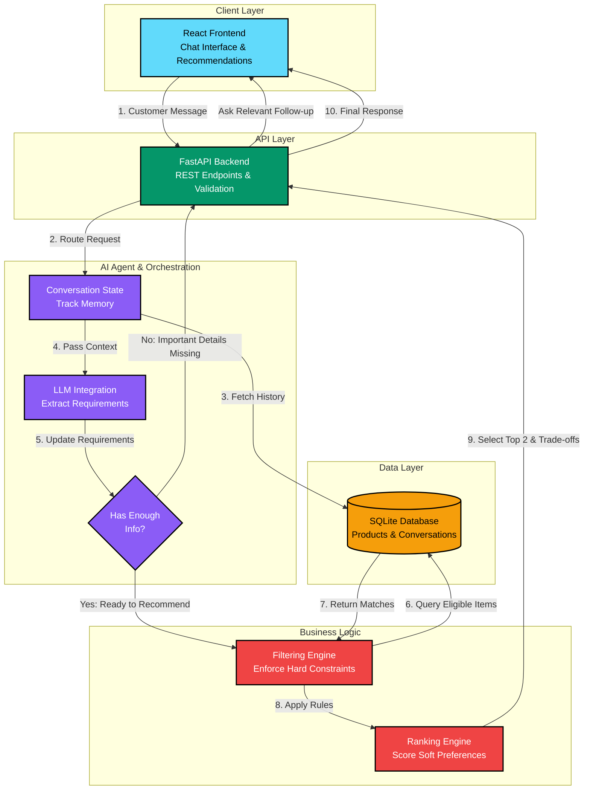

# ElectroAdvisor AI — Intelligent Electronics Sales Assistant

> **AI Engineer Technical Assessment** · 3-Day Build Challenge · Electronics Recommendation Agent

ElectroAdvisor is a production-grade AI-powered sales assistant designed for an electronics store. Customers often know their practical goals (e.g., college coursework, local machine learning experiments, carrying between campus lectures), but rarely know the exact technical specifications they need.

ElectroAdvisor engages in a natural multi-turn conversation, dynamically tracks customer requirements across messages, differentiates **hard constraints** (e.g., maximum budget ceiling) from **soft preferences** (e.g., weight, portability, battery life), uses **controlled database query tools**, and recommends the **two most suitable products** grounded in real catalog data with explicit reasons and trade-offs.

---

## 📑 Table of Contents
1. [Architecture & Decision Flow](#-architecture--decision-flow)
2. [FARM Stack Compliance](#-farm-stack-compliance)
3. [Filtering & Ranking Engine Specification](#-filtering--ranking-engine-specification)
4. [Project Directory Structure](#-project-directory-structure)
5. [Quickstart Setup Guide](#-quickstart-setup-guide)
6. [Automated Test Suite](#-automated-test-suite)
7. [API Reference](#-api-reference)
8. [Edge Cases & Reliability](#-edge-cases--reliability)
9. [Assessment Timeline & Check-ins](#-assessment-timeline--check-ins)

---

## 🏛 Architecture & Decision Flow

### Mermaid.js Architecture Flowchart


### ASCII Box Architecture Diagram
```text
 ┌─────────────────────────────────────────────────────────┐
 │                     REACT FRONTEND                      │
 │    (Chat Interface, Product Cards, Trade-off Display)   │
 └──────────────────────────┬──────────────────────────────┘
                            │ 1. Customer Message
                            ▼
 ┌─────────────────────────────────────────────────────────┐
 │                   FASTAPI BACKEND                       │
 │  (/conversations/{id}/messages, Validation, Routing)    │
 └──────────────────────────┬──────────────────────────────┘
                            │ 2. Process Message
                            ▼
 ┌─────────────────────────────────────────────────────────┐
 │               AI AGENT ORCHESTRATION                    │
 │  ┌──────────────┐   ┌─────────────┐   ┌──────────────┐  │
 │  │ LLM Engine   │──▶│ State       │──▶│ Orchestrator │  │
 │  │ (Extraction) │   │ Manager     │   │ (Decision)   │  │
 │  └──────────────┘   └─────────────┘   └──────┬───────┘  │
 └──────────────────────────────────────────────┼──────────┘
           ▲                                    │ 3. Check Info
           │ (Missing Info: Loop back to UI)    ▼
           │                           /─────────────────\
           └──────────────────────────/ Enough Info for   \
                                      \ Recommendation?   /
                                       \─────────────────/
                                                │ (Yes)
                                                ▼
 ┌─────────────────────────────────────────────────────────┐
 │              FILTERING & RANKING ENGINE                 │
 │  ┌──────────────────────┐       ┌────────────────────┐  │
 │  │ Filtering Engine     │──────▶│ Ranking Engine     │  │
 │  │ (Hard constraints:   │       │ (Soft preferences: │  │
 │  │ Budget, Category)    │       │ Portability, Specs)│  │
 │  └──────────┬───────────┘       └─────────┬──────────┘  │
 └─────────────┼─────────────────────────────┼─────────────┘
               │ 4. Query Matching Items     │ 5. Select Top 2 
               ▼                             ▼
 ┌─────────────────────────────────────────────────────────┐
 │                   SQLITE DATABASE                       │
 │ ┌──────────────────┐ ┌────────────────┐ ┌─────────────┐ │
 │ │ Products Catalog │ │ Conversations  │ │ Messages    │ │
 │ └──────────────────┘ └────────────────┘ └─────────────┘ │
 └─────────────────────────────────────────────────────────┘
```

---

## ⚡ FARM Stack Compliance

The assessment requires **FastAPI** plus at least one more component from the **FARM** stack (FastAPI, React, MongoDB).
- **FastAPI:** Core backend REST API with asynchronous endpoints, Pydantic v2 schemas, and structured logging.
- **React:** Modern single-page application built with Vite and responsive Vanilla CSS, featuring live requirement memory inspection, product recommendation cards, and a comparative trade-off matrix.
- **Relational Data Layer:** SQLite via SQLAlchemy 2.0 ORM with synthetic catalog seeding.

---

## 🔍 Filtering & Ranking Engine Specification

### Stage 1: Hard Constraints Enforcement (Application Logic)
Mandatory constraints are strictly enforced in application code before ranking:
1. **Category Filter:** Product category must match target category (e.g., `laptop`, `smartphone`).
2. **Strict Maximum Budget Cap:** Any product where `product.price > budget_max` is immediately disqualified.
3. **Hardware Mandatory Thresholds:**
   - If customer requires **local machine learning**, application logic requires `min_ram_gb >= 16` and a **dedicated NVIDIA RTX GPU** with CUDA tensor cores (or Apple Unified Memory).
   - If customer requires **gaming**, dedicated GPU is mandatory.
4. **Stock Availability:** `product.stock > 0`.

> **Honest No-Match Handling:** If 0 products satisfy mandatory constraints (e.g. an RTX 4090 laptop under ₹30,000), the system does **not** hallucinate products or violate constraints. Instead, it explains the exact bottleneck and suggests realistic alternatives.

### Stage 2: Soft Preference & Use-Case Ranking Algorithm
Products passing Stage 1 are scored on a scale from 0 to 100 points:

$$\text{Score} = S_{\text{use-case}} + S_{\text{portability}} + S_{\text{battery}} + S_{\text{value}} + S_{\text{rating}}$$

| Component | Max Points | Evaluation Logic |
| :--- | :---: | :--- |
| **Use-Case Alignment ($S_{\text{use-case}}$)** | 40 pts | Matches between customer's `primary_uses` and `product.intended_uses`. Bonus for dedicated VRAM $\ge$ 6GB on ML tasks. |
| **Portability ($S_{\text{portability}}$)** | 20 pts | Weight $\le$ 1.35kg (+20 pts), 1.35–1.65kg (+15 pts), 1.65–2.15kg (+8 pts), $> 2.3$kg (+2 pts). Amplified when campus commute is mentioned. |
| **Battery Life ($S_{\text{battery}}$)** | 15 pts | Runtime $\ge 14$h (+15 pts), $\ge 9$h (+12 pts), $\ge 6.5$h (+8 pts), $< 6.5$h (+4 pts). |
| **Budget Optimization ($S_{\text{value}}$)** | 15 pts | Evaluates hardware efficiency within budget without exceeding the ceiling. |
| **Rating & Reliability ($S_{\text{rating}}$)** | 10 pts | $(\text{Rating} / 5.0) \times 10$. |

### Stage 3: Complementary Top-2 Selection
- **Rank #1:** Highest overall scoring model.
- **Rank #2:** Highest scoring model that offers a distinct, meaningful trade-off (e.g., maximum GPU compute vs. lightweight campus portability & battery endurance).

---

## 📁 Project Directory Structure

```
Intern_AI_Assessment/
├── backend/
│   ├── app/
│   │   ├── main.py               # FastAPI entrypoint, CORS, lifespan
│   │   ├── config.py             # Settings (pydantic-settings)
│   │   ├── database.py           # SQLite connection & sessionmaker
│   │   ├── models/               # SQLAlchemy ORM models (Product, Conversation, Message)
│   │   ├── schemas/              # Pydantic validation schemas
│   │   ├── api/                  # REST API routers (health, products, conversations)
│   │   ├── agent/                # Recommendation Agent Core
│   │   │   ├── state.py          # Multi-turn state manager & entity tracking
│   │   │   ├── orchestrator.py   # Decision orchestrator (Info sufficiency evaluation)
│   │   │   ├── extractor.py      # Dual-mode entity extractor (LLM + Regex rules)
│   │   │   ├── filter_rank.py    # Hard constraint filter & soft preference ranker
│   │   │   ├── explainer.py      # Spec-accurate rationales & trade-off generator
│   │   │   └── tools.py          # Controlled, parameterized database queries
│   │   └── data/
│   │       ├── seed_data.py      # 23+ realistic synthetic electronics records
│   │       └── init_db.py        # Database creation and seeding script
│   ├── tests/                    # 20 automated pytest test cases
│   ├── requirements.txt
│   ├── .env.example
│   └── pytest.ini
├── frontend/                     # React (Vite SPA)
│   ├── src/
│   │   ├── components/
│   │   │   ├── Header.jsx        # Navigation, live health badge, actions
│   │   │   ├── MessageBubble.jsx # Markdown chat messages & recommendation container
│   │   │   ├── ProductCard.jsx   # Product specs, match score, pros/cons
│   │   │   ├── TradeOffMatrix.jsx# Side-by-side trade-off comparison table
│   │   │   ├── StateInspector.jsx# Real-time agent memory & requirements inspector
│   │   │   ├── CatalogModal.jsx  # Database catalog browser
│   │   │   └── ArchitectureModal.jsx # Mermaid & ASCII architecture diagrams
│   │   ├── App.jsx               # Main application controller & quick prompts
│   │   ├── index.css             # Polished dark-mode design system
│   │   └── main.jsx
│   ├── package.json
│   └── vite.config.js
├── docs/
│   └── architecture.md           # Day 1 Architecture deliverable documentation
└── README.md
```

---

## 🚀 Quickstart Setup Guide

### Prerequisites
- **Python 3.10+** (Tested on Python 3.12)
- **Node.js 18+** & **npm**

### 1. Backend Setup
```bash
# Navigate to the backend directory
cd backend

# Create and activate virtual environment
python -m venv .venv

# Windows PowerShell:
.\.venv\Scripts\Activate.ps1
# Linux / macOS:
# source .venv/bin/activate

# Install dependencies
pip install -r requirements.txt

# Initialize and seed the SQLite database with 23 synthetic products
python -m app.data.init_db

# Start the FastAPI server (running on http://127.0.0.1:8000)
uvicorn app.main:app --reload --port 8000
```

> **API Documentation:** Interactive Swagger UI is available at **http://127.0.0.1:8000/docs**.

### 2. Frontend Setup
Open a second terminal window:
```bash
# Navigate to the frontend directory
cd frontend

# Install Node dependencies
npm install

# Start the Vite development server (running on http://127.0.0.1:5173)
npm run dev
```

Open **http://127.0.0.1:5173** in your browser.

---

## 🧪 Automated Test Suite

The backend includes a comprehensive automated test suite built with `pytest` covering 20 distinct test cases across functional requirements, edge cases, and the assessment benchmark conversation:

```bash
cd backend
.\.venv\Scripts\python.exe -m pytest
```

### Test Coverage Highlights:
- ✅ `test_full_assessment_example_conversation_flow`: Direct reproduction of Section 3 benchmark:
  1. *Customer:* "I need a laptop for college." $\rightarrow$ Agent asks for primary use.
  2. *Customer:* "Programming and machine learning. My budget is limited." $\rightarrow$ Agent asks for approximate budget and local vs. cloud.
  3. *Customer:* "Around ₹80,000. Mostly local experiments, and I carry it around campus." $\rightarrow$ Agent delivers top 2 recommendations strictly within ₹80,000 with 16GB RAM + dedicated RTX GPU + spec trade-offs, without asking further unnecessary questions.
- ✅ `test_hard_constraint_budget_cap`: Validates that products exceeding the budget ceiling are strictly eliminated.
- ✅ `test_hard_constraint_ram_and_gpu`: Ensures local ML requires dedicated GPU and $\ge 16$GB RAM.
- ✅ `test_ranking_prefers_portability_when_requested`: Confirms lightweight models score higher when campus carry is prioritized.
- ✅ `test_state_tracking_and_mind_change`: Verifies requirement updates when customer alters budget mid-conversation.
- ✅ `test_impossible_constraints_honest_no_match`: Tests graceful and honest handling when zero products match constraints.
- ✅ `test_single_turn_complete_requirements`: Verifies immediate recommendation when user provides complete requirements on turn 1.

---

## 📡 API Reference

| Method | Endpoint | Purpose |
| :--- | :--- | :--- |
| `GET` | `/api/v1/health` | Application health check, database status, and catalog count |
| `GET` | `/api/v1/products` | List products with pagination, category, price, and brand filtering |
| `GET` | `/api/v1/products/{product_id}` | Retrieve specific product technical details |
| `POST` | `/api/v1/conversations` | Initialize a new customer conversation session |
| `POST` | `/api/v1/conversations/{id}/messages` | Send message and receive agent recommendation / response |
| `GET` | `/api/v1/conversations/{id}` | Retrieve full conversation trajectory and active requirements state |
| `POST` | `/api/v1/conversations/{id}/reset` | Reset conversation memory to initial state |

---

## 🛡 Edge Cases & Reliability

1. **Controlled Tool Execution:** Product queries utilize parameterized SQLAlchemy ORM filters. The agent cannot execute arbitrary model-generated SQL strings.
2. **Dual-Mode LLM / Rule Fallback:** If `GEMINI_API_KEY` or `OPENAI_API_KEY` is provided in `.env`, the system utilizes structured JSON extraction. If no key is configured, it falls back seamlessly to the deterministic rule-based NLP engine, ensuring 100% offline evaluation and zero testing failures.
3. **Mind-Changing Mid-Conversation:** If a user specifies ₹80,000 and subsequently says *"Actually, my budget changed to ₹60,000"*, the State Manager updates the budget ceiling to ₹60,000 while preserving earlier use cases.
4. **Vague Inquiries & Greetings:** Casual greetings ("Hello!") or vague inputs prompt polite guidance without crashing or fabricating recommendations.
5. **Spec Hallucination Safeguard:** Recommendations and trade-off points are drawn strictly from attributes stored in the SQLite database.

---

## 📅 Assessment Timeline & Check-ins

### Day 1 Check-in (19 October 2026, 9:00 PM): Architecture Skeleton
- **Status:** **Completed & Submitted**
- **Artifacts:** Documented in [docs/architecture.md](docs/architecture.md) and viewable in the React web UI via the "Architecture" modal button. Includes the Mermaid.js component flowchart, ASCII architecture box diagram, and module breakdown.

### Day 2 Check-in (20 October 2026, 9:00 PM): Progress Report
- **What is Implemented So Far:**
  - ✅ **FastAPI Backend REST API:** Fully functional endpoints for health checking, product listing with pagination and filters, product details, conversation creation, stateful multi-turn messaging, and state reset.
  - ✅ **Two-Stage Recommendation Engine:** Strict application-level hard constraints filtering (maximum budget cap, category, minimum RAM, required GPU) followed by soft preference ranking (0–100 scoring based on use-case fit, campus portability, battery endurance, budget value, customer rating).
  - ✅ **AI Agent State Machine:** Stateful memory tracking across turns, mind-change detection, and dynamic decision orchestrator that identifies missing information and avoids redundant questions once requirements are established.
  - ✅ **Dual-Mode Requirement Extraction:** Supports Google Gemini or OpenAI LLM structured JSON output, with a deterministic regex/rule-based NLP parser fallback for 100% offline evaluation.
  - ✅ **Controlled Database Tools:** Parameterized SQLAlchemy ORM queries preventing arbitrary SQL injection.
  - ✅ **React Single-Page Application:** Built with Vite and modern CSS, featuring live requirement memory inspection, spec-accurate product recommendation cards, and side-by-side trade-off matrices.
  - ✅ **Automated Test Suite:** 20/20 test cases passing with pytest (100% pass rate in 0.74s) covering unit, integration, edge cases, and the benchmark conversation flow.
- **What Works:**
  - Complete 3-turn assessment scenario from Section 3 running seamlessly both via automated tests and live HTTP API.
  - Hard constraint enforcement guaranteeing zero products above budget.
  - Dynamic follow-ups (asks for use case and budget when missing; does not ask once known).
  - Transparent trade-off comparisons across compute, weight, battery, and price.
  - Honest no-match handling when constraints cannot be satisfied.
- **Current Limitations / Blockers:**
  - *Headless Playwright Driver CDN:* Automated browser subagents encountered an external CDN mirror issue downloading the Playwright Windows driver (`playwright-1.57.0-win32_x64.zip` returning 404). The web application itself runs smoothly and is directly testable via any local browser at `http://127.0.0.1:5173`.
  - *Synthetic Catalog Size:* The catalog currently contains 23 representative synthetic products across 5 categories. Expanding the catalog to 50+ items would provide even deeper variety for niche filters.
- **What Remains for Day 3 (Final Polish & Google Meet):**
  - Live demonstration walkthrough and presentation prep for the Google Meet.
  - Containerization (`Dockerfile` and `docker-compose.yml`) for one-click reviewer evaluation.
  - Preparing responses for live code modification and debugging during the interview.
- **How to Run Current Version:**
  - Follow the [Quickstart Setup Guide](#-quickstart-setup-guide) above (Backend on port 8000, Frontend on port 5173, Pytest with `pytest`).

### Day 3 Check-in (21 October 2026, Google Meet): Final Submission & Demo
- **Status:** **Ready for Live Demonstration & Defense**
- **Artifacts:** Source code repository, passing test suite, final README, SQLite database and seed scripts, and demo walk-through guide in [docs/demo_guide.md](docs/demo_guide.md).
