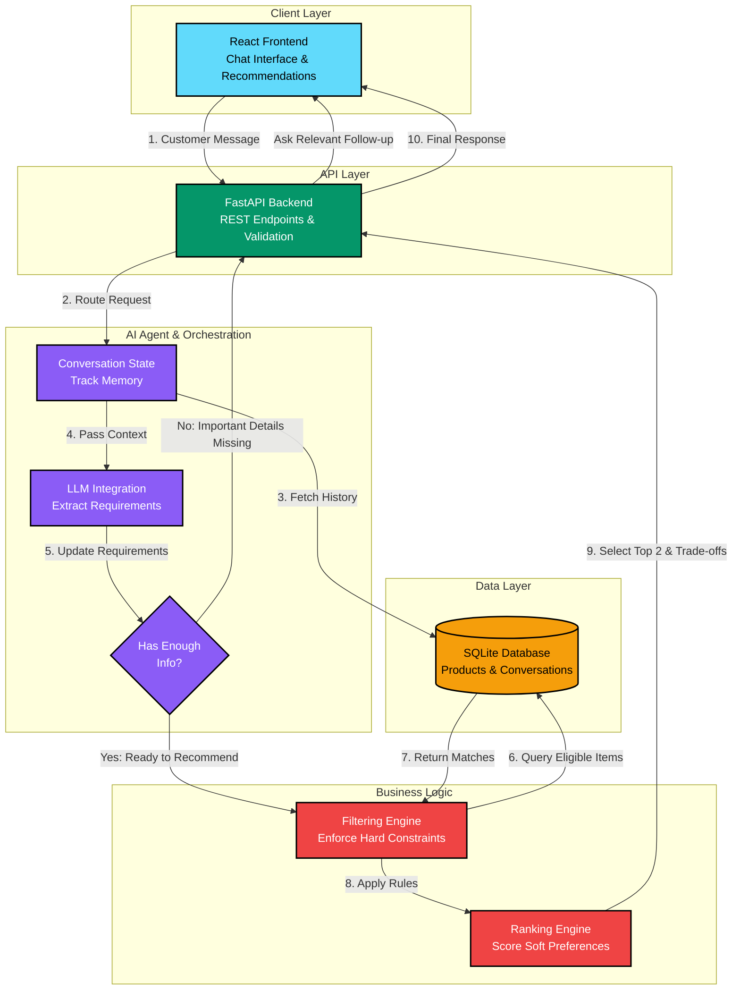

# Architecture Skeleton & System Design

**Assessment:** AI Engineer Technical Assessment (Electronics Recommendation Agent)  
**Deliverable:** Day 1 Architecture Skeleton  
**Stack:** FARM Stack (FastAPI, React, SQLite / relational catalog) + Modular AI Orchestrator

---

## 1. System Architecture Diagram (Mermaid.js)



---

## 2. ASCII Box Architecture Diagram

```text
 ┌─────────────────────────────────────────────────────────┐
 │                     REACT FRONTEND                      │
 │    (Chat Interface, Product Cards, Trade-off Display)   │
 └──────────────────────────┬──────────────────────────────┘
                            │ 1. Customer Message
                            ▼
 ┌─────────────────────────────────────────────────────────┐
 │                   FASTAPI BACKEND                       │
 │  (/conversations/{id}/messages, Validation, Routing)    │
 └──────────────────────────┬──────────────────────────────┘
                            │ 2. Process Message
                            ▼
 ┌─────────────────────────────────────────────────────────┐
 │               AI AGENT ORCHESTRATION                    │
 │  ┌──────────────┐   ┌─────────────┐   ┌──────────────┐  │
 │  │ LLM Engine   │──▶│ State       │──▶│ Orchestrator │  │
 │  │ (Extraction) │   │ Manager     │   │ (Decision)   │  │
 │  └──────────────┘   └─────────────┘   └──────┬───────┘  │
 └──────────────────────────────────────────────┼──────────┘
           ▲                                    │ 3. Check Info
           │ (Missing Info: Loop back to UI)    ▼
           │                           /─────────────────\
           └──────────────────────────/ Enough Info for   \
                                      \ Recommendation?   /
                                       \─────────────────/
                                                │ (Yes)
                                                ▼
 ┌─────────────────────────────────────────────────────────┐
 │              FILTERING & RANKING ENGINE                 │
 │  ┌──────────────────────┐       ┌────────────────────┐  │
 │  │ Filtering Engine     │──────▶│ Ranking Engine     │  │
 │  │ (Hard constraints:   │       │ (Soft preferences: │  │
 │  │ Budget, Category)    │       │ Portability, Specs)│  │
 │  └──────────┬───────────┘       └─────────┬──────────┘  │
 └─────────────┼─────────────────────────────┼─────────────┘
               │ 4. Query Matching Items     │ 5. Select Top 2 
               ▼                             ▼
 ┌─────────────────────────────────────────────────────────┐
 │                   SQLITE DATABASE                       │
 │ ┌──────────────────┐ ┌────────────────┐ ┌─────────────┐ │
 │ │ Products Catalog │ │ Conversations  │ │ Messages    │ │
 │ └──────────────────┘ └────────────────┘ └─────────────┘ │
 └─────────────────────────────────────────────────────────┘
```

---

## 3. Component Breakdown

### 3.1 Client Layer (React Frontend)
- **Chat Interface:** Natural conversational interaction with dynamic auto-scrolling, typing indicators, and quick suggestion prompts.
- **Product Card Display:** Grounded catalog presentation displaying verified specs (CPU, RAM, GPU, weight, battery), suitability scores, and advantages.
- **Trade-off Matrix:** Side-by-side comparative table contrasting the top 2 models on compute performance, portability, battery life, and price value.
- **Live State Inspector:** Real-time visibility into the agent's internal state (category, budget ceiling, primary uses, hard constraints, soft preferences, missing fields).

### 3.2 API Layer (FastAPI Backend)
- **REST Endpoints:** Strictly typed endpoints with Pydantic validation:
  - `GET /api/v1/health`: Health monitoring and catalog verification.
  - `GET /api/v1/products`: Filterable, paginated product catalog query.
  - `GET /api/v1/products/{id}`: Direct product record retrieval.
  - `POST /api/v1/conversations`: Initializes stateful conversation.
  - `POST /api/v1/conversations/{id}/messages`: Processes customer utterances and returns agent decisions.
  - `GET /api/v1/conversations/{id}`: Retrieves full conversation trajectory and active requirements state.

### 3.3 AI Agent Orchestration
- **Dual-Mode Requirement Extraction:** Supports Google Gemini or OpenAI LLM structured JSON output when configured, backed by a deterministic, zero-dependency regex NLP engine for 100% offline reproducibility.
- **State Manager:** Preserves previously established requirements while tracking changes of mind (e.g., customer altering budget from ₹80,000 to ₹60,000).
- **Decision Orchestrator:** Evaluates requirement completeness. If essential details are missing (e.g. use case or budget), it generates a single focused follow-up question. If requirements are sufficient, it transitions directly to recommendation without unnecessary questioning.

### 3.4 Business Logic (Filtering & Ranking Engine)
- **Controlled Tool Execution:** Queries SQLite through parameterized SQLAlchemy expressions, completely preventing arbitrary model-generated SQL.
- **Stage 1 (Hard Filtering):** Strict enforcement of mandatory rules:
  - Strict maximum budget ceiling (`price <= budget_max`)
  - Target category matching (`laptop`, `smartphone`, etc.)
  - Minimum RAM and dedicated GPU checks for compute-heavy workloads (local machine learning or gaming).
- **Stage 2 (Soft Preference Ranking):** Multi-factor scoring (0–100 points) based on:
  - Use-case alignment (0–40 pts)
  - Portability & battery preferences (0–30 pts)
  - Budget value optimization (0–20 pts)
  - Customer rating (0–10 pts)
- **Top 2 Selection & Trade-Off Explainer:** Selects the top complementary products and articulates real-world trade-offs (performance vs weight vs battery).

### 3.5 Data Layer (SQLite Database)
- **Products Catalog:** Synthetic records spanning laptops, smartphones, tablets, monitors, and headphones with comprehensive technical specifications, intended uses, pros, and cons.
- **Conversations & Messages:** Persistent multi-turn dialogue history and active state tracking.
